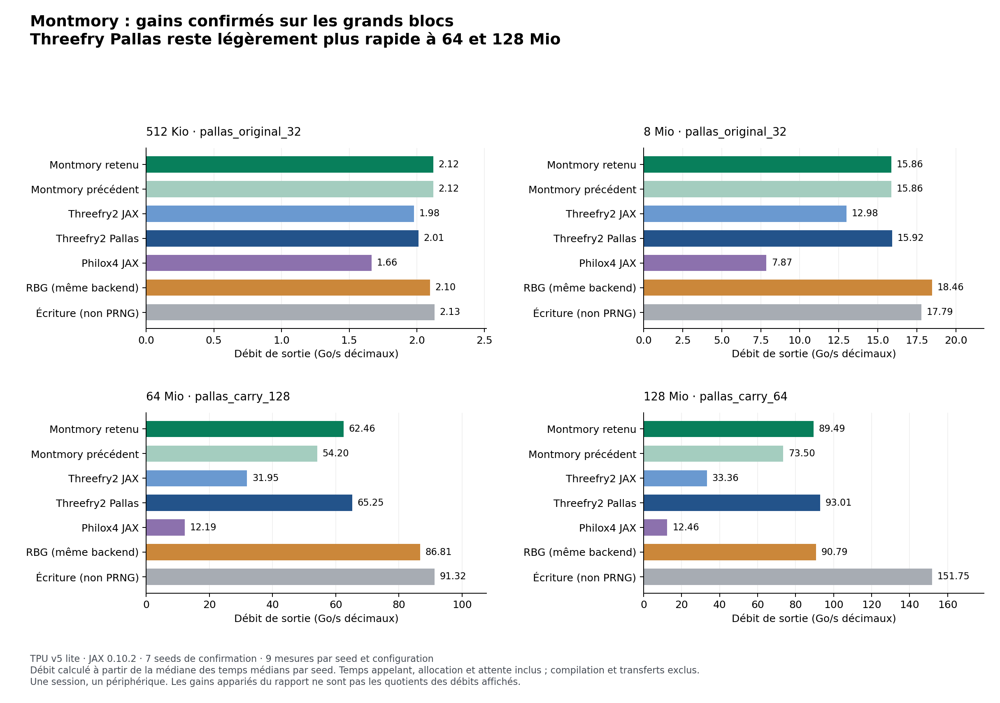

# Montmory PRNG — méthode, résultats et preuves

[Français](README.fr.md) · [English](README.md) · [Documentation FR/EN](docs/languages.md)

[Premiers contrôles](docs/start-here.fr.md) · [Résultats](docs/results.md) · [Méthodologie](docs/methodology.md) · [Reproduire](docs/reproduce.md) · [Registre des preuves](docs/evidence.md)

**Ce dépôt rend vérifiable le travail réalisé sur Montmory : moteur entier déterministe, portages CPU/GPU/TPU, tests statistiques et optimisations conservant les sorties.** Il rassemble les travaux disponibles au **21 octobre 2026**. Les développements du moteur sont en pause.

## Pourquoi optimiser un PRNG logiciel sur TPU ?

Les TPU disposent d'un PRNG matériel séquentiel rapide dont l'implémentation varie selon la génération du circuit. JAX déconseille de dépendre de son comportement exact et recommande Threefry logiciel lorsque la stabilité du flux importe. [Documentation JAX du PRNG matériel](https://docs.jax.dev/en/latest/pallas/tpu/prng.html#using-the-hardware-prng).

**Notre objectif est de nous approcher du débit utile de génération de l'accélérateur tout en conservant un flux entier exactement défini et portable.** Nous optimisons les implémentations logicielles de Threefry et de Montmory pour permettre de changer la stratégie d'exécution en conservant les sorties définies. Le contrat du flux est spécifié par le logiciel, plutôt que par la génération du TPU. Les preuves natives TPU couvrent actuellement **un seul TPU v5 lite** ; la validation sur d'autres générations reste à effectuer.

À 128 Mio, cette campagne rapporte **93,006 Go/s pour Threefry Pallas, 89,488 Go/s pour Montmory Pallas et 90,791 Go/s pour JAX/XLA RBG**. Le chemin RBG mesuré est un comparateur via une API, pas une mesure directe du débit maximal du PRNG matériel. Cette comparaison motive le travail sans prétendre que le logiciel égale le générateur silicium dans toute application. [PRNG matériel, RBG mesuré et portée de la comparaison](docs/results.md#prng-matériel-et-comparateur-rbg-mesuré).

Ces travaux sont menés par **Pascal Montmory, fondateur et président d'ENINCA CONSULTING, pour la société**. Le dépôt présente le moteur Montmory et les implémentations optimisées de l'algorithme préexistant Threefry, avec leurs références et conditions de reproduction.

**Langues :** la documentation actuelle et les instructions des notebooks sont disponibles en français et en anglais, via les liens ci-dessus. Les sources, journaux et données historiques conservent leurs octets d’origine. Les documents juridiques privés et leur historique Git sont exclus de cette édition publique. Voir le [guide des langues](docs/languages.md).

L'apport technique principal est la conservation du flux de référence malgré des stratégies d'exécution différentes. Pour reproduire ce flux, il faut fixer **la version, la seed, l'indice global et la géométrie des lanes logiques**. La seed seule ne suffit pas. [Définition exacte](docs/contract.md).

## Ce que nous avons établi

| Sujet | Conclusion | Portée des preuves |
|---|---|---|
| Reproductibilité | Accord des sorties contrôlées sur x86, ARM64, Metal et TPU. | [Matrice de conformité](docs/evidence.md) ; contrôles finis, sans garantie universelle sur toutes les entrées. |
| TestU01 | SmallCrush, Crush et BigCrush réussis dans les journaux historiques ; réussite également annoncée pour le moteur natif M3 v3. | [Détail des batteries](docs/testu01.md). Pour le dernier BigCrush M3 v3, nous possédons le résumé terminal, pas l'archive intégrale. |
| Optimisation TPU | **+15,42 % à 64 Mio et +23,25 % à 128 Mio**, par rapport au précédent noyau Montmory Pallas. | Un TPU v5 lite ; sept seeds de confirmation distinctes de la recherche ; 3 708 mesures auditées. |
| Comparaison aux autres PRNG | Threefry optimisé Pallas reste environ **4 % plus rapide** sur ces grands volumes. Threefry et Philox devancent aussi Montmory dans la confirmation M3 rapportée. | [Comparaisons et conditions de mesure](docs/results.md). Aucun titre de « meilleur PRNG » n'est revendiqué. |
| Diagnostics TACM complémentaires | **Aucun avantage statistique établi parmi 54 comparaisons de MSE prévues à l'avance.** | Dix moteurs, 2 048 seeds par moteur, six fonctions ; [protocole corrigé](docs/tacm.md). |
| Propriétés mathématiques | Le mélangeur final est non injectif. L'uniformité exacte et la sécurité cryptographique ne sont pas établies. | [Certificats exacts et limites](docs/contract.md). |



Les débits représentent les octets produits divisés par le temps de l'appel. Ils ne représentent ni une spécification de bande passante du TPU, ni l'accélération d'un calcul VaR complet.

## Parcours de lecture

1. [Contrat du moteur](docs/contract.md) : définition et propriétés conservées.
2. [Méthodologie](docs/methodology.md) : conformité, calibration, recherche et confirmation.
3. [Résultats](docs/results.md) : gains, comparaisons et essais non concluants.
4. [Comprendre le CSV](docs/csv-guide.md) : unités et calcul des ratios, avec un exemple à 128 Mio.
5. [Preuves disponibles](docs/evidence.md) : distinction entre données brutes auditées, journaux historiques et extraits terminal.
6. [Reproduire](docs/reproduce.md) : contrôles accessibles sur CPU, puis campagnes natives.
7. [Limites](docs/limitations.md), [historique des corrections](docs/history.md), [références](docs/references.md).

Le [classeur de lecture](results/Montmory_TPU_resultats_lisibles.xlsx) contient les 3 708 mesures TPU et leur synthèse. Les grandes seeds y sont conservées comme texte pour éviter leur arrondi par Excel.

Un [glossaire](docs/glossary.md) explique les termes utilisés dans les protocoles et les tableaux.

Le [benchmark applicatif JAX](docs/benchmark-applicatif.md) ajoute des uniformes, des normales et un calcul Monte-Carlo à la génération brute. Il est vérifié localement sur CPU ; ses performances natives TPU restent à mesurer.

Le [prototype Sobol32 séparé](applications/sobol/README.fr.md) étudie la génération exacte de points à faible discrépance avec des implémentations par blocs JAX et Pallas. La conformité CPU est contrôlée ; la compilation native TPU et ses performances restent à vérifier.

L’[expérience d’entraînement avec dropout](applications/dropout/README.fr.md) compare Montmory et Threefry dans un petit réseau neuronal, avec génération et application du masque fusionnées dans Pallas. Les contrôles CPU, les courbes d’apprentissage et les notebooks Colab français/anglais sont disponibles. **La compilation native TPU et les gains éventuels sur l’entraînement restent à valider.**

## Vérifier sans posséder de TPU

Avec Python 3.11+ et un compilateur C :

```bash
git clone https://github.com/pascalMontmory/montmory-prng-research.git
cd montmory-prng-research
python3 scripts/check_repository.py
python3 scripts/check_reference.py
```

Avec NumPy, l'audit des données TPU peut aussi être rejoué sur CPU :

```bash
python3 scripts/replay_audit.py tpu
```

Cela recalcule les conclusions et les références C à partir des résultats archivés ; cela ne lance pas de nouveau test sur TPU. Les [instructions complètes](docs/reproduce.md) expliquent chaque niveau de reproduction.

Le [rapport de vérification du dépôt](results/repository-validation.json) conserve les contrôles locaux et les quatre réanalyses CPU réussies lors de sa constitution.

**Édition publique :** ce dépôt possède un historique neuf contenant uniquement le dossier scientifique. [Périmètre de publication](docs/publication.md) · [GitHub Actions](https://github.com/pascalMontmory/montmory-prng-research/actions). Les rapports locaux historiques restent distincts de tout nouveau résultat de CI hébergée.

## Organisation du dépôt

```text
src/reference/   référence C/Python inchangée et 1 600 vecteurs connus
applications/    benchmark applicatif, contrôles CPU et preuves séparées
docs/            explications, méthodologie, résultats et limites en FR/EN
evidence/        index des affirmations, empreintes, provenance et exclusions
studies/         sources figées, protocoles, données brutes et analyses historiques
notebooks/       notebooks autonomes de validation et d'optimisation TPU native
results/         classeur de lecture et rapport de vérification du dépôt
scripts/         contrôles d'intégrité, référence exacte et réanalyses CPU
third_party/     notices des dépendances, également conservées dans chaque kit
```

Les fichiers de `studies/` sont des archives de travail figées. Ils conservent les réserves et chemins de leur date de rédaction. La documentation de `docs/` fournit la lecture actuelle et indique les preuves encore manquantes.

Une équipe qui découvre le projet peut commencer par le [guide de prise en main](docs/start-here.fr.md) : premiers contrôles CPU, carte des sources Montmory/Threefry, exemple d’appel et parcours TPU.

Ce dépôt constitue un dossier de recherche. Il ne démontre pas une supériorité universelle, une sécurité cryptographique ou une validation bancaire. Les conditions des dépendances sont conservées dans [les notices des tiers](THIRD_PARTY_NOTICES.fr.md). Aucune nouvelle licence de diffusion du travail original n'est accordée ici. Pour citer un résultat, conserver l'identifiant du commit et celui de la campagne.
