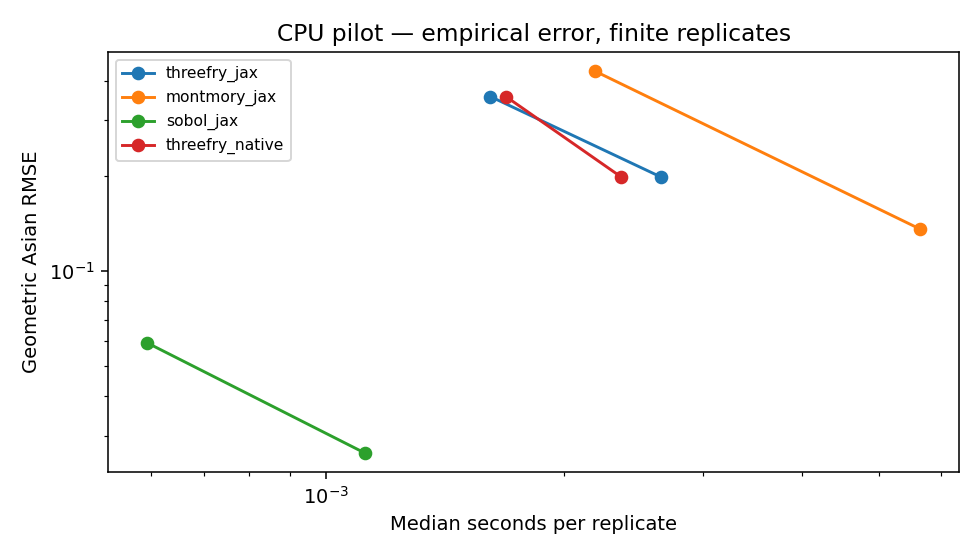

# Option asiatique : Monte-Carlo et Sobol randomisé

[Français](README.fr.md) · [English](README.md) · [Accueil](../../README.fr.md)

Par Pascal Montmory pour ENINCA CONSULTING. **Pilote CPU exécuté ; performances et compilation natives TPU à valider.** Cette expérience ne constitue pas un moteur de valorisation bancaire validé. Elle utilise les moteurs historiques inchangés et le [prototype Sobol32](../sobol/README.fr.md). Voir les [droits](../../LICENSE) et [notices des tiers](../../THIRD_PARTY_NOTICES.fr.md).

[Ouvrir dans Colab](https://colab.research.google.com/github/pascalMontmory/montmory-prng-research/blob/main/applications/asian_option/notebooks/Eninca_Asian_Option_TPU.ipynb) · [Notebook français](notebooks/Eninca_Asian_Option_TPU.ipynb) · [English notebook](notebooks/Eninca_Asian_Option_TPU.en.ipynb)

## Question étudiée

Combien de temps faut-il pour atteindre une erreur donnée sur une espérance financière ? Le programme compare la simulation Monte-Carlo avec Threefry et Montmory à la simulation quasi-Monte-Carlo avec Sobol randomisé. La qualité est mesurée sur le prix, pas sur le seul débit des nombres générés.

Deux calls asiatiques sont calculés sur les mêmes trajectoires : moyenne **arithmétique**, et moyenne **géométrique**. Le cas géométrique possède une référence analytique ; il fournit le critère principal de précision. Le prix arithmétique utilise une référence numérique séparée, avec son incertitude affichée.

## Modèle et référence

Modèle de Black–Scholes sous probabilité risque-neutre : S0=100, K=100, r=0,03, sigma=0,20, maturité=1 an. Les paramètres effectivement utilisés sont les valeurs float32 archivées, converties en float64 pour les références. Il y a 128 observations équidistantes, de T/128 à T ; **S0 n’entre pas dans la moyenne**. Pas de dividendes, pont brownien, variable de contrôle ni sélection de paramètres après observation.

Les incréments logarithmiques utilisent la solution exacte du mouvement brownien géométrique aux dates d’observation, et non une discrétisation d’Euler du prix. Les payoffs sont actualisés à l’origine. Si G est la moyenne géométrique et n=128 :

```text
E[log G] = log S0 + (r - sigma²/2) T (n+1)/(2n)
Var(log G) = sigma² T (n+1)(2n+1)/(6n²)
```

Le prix géométrique lognormal vaut environ **5,11913** pour ce marché. La formule est contrôlée par quadrature numérique indépendante, par la covariance brownienne et par le cas de volatilité nulle. Le cas n=1 est aussi vérifié. L’implémentation originale de cette formule figure dans [pricing.py](pricing.py).

## Méthodes comparées

- Threefry JAX et Montmory JAX ; ajout de leurs variantes Pallas sur TPU, tuile fixe de 8 × 128 paires.
- Sobol LMS+shift fourni par SciPy, 128 dimensions ; bloc JAX de 256 points, bloc Pallas de 256 sur TPU. Chaque réplication emploie un brouillage distinct. On conserve les premiers `2^m` points, y compris le point zéro du réseau brouillé, sans saut ni sous-échantillonnage.
- Un comparateur `threefry_native` utilise directement `jax.random.normal`. Il n’a pas le même contrat de transformation que les autres chemins.
- Pour les autres chemins, chaque uint32 devient `((word >> 9)+0.5)*2^-23`, puis une normale par inverse de la CDF. Ce maillage float32 exclut 0 et 1, mais limite les queues et la précision des normales. C’est une approximation du modèle continu ; ce biais n’est pas supprimé en augmentant le nombre de trajectoires.
- Montmory garde T=2048,D=4096 et la base `2^32-4097`. La paire i utilise les moitiés basse et haute du mot base+i ; Threefry utilise les positions partitionnables JAX 2i et 2i+1. Les coordonnées aplaties sont rangées par trajectoire puis date. Les paramètres Sobol exportés, et pas la seed seule, définissent son flux.

## Mesures et précision

Pilote : 512 et 2 048 trajectoires, quatre seeds fixées, trois chronométrages par seed. Protocole complet : 4 096, 16 384 et 65 536 trajectoires, seize seeds fixées, cinq chronométrages. Les répétitions temporelles réutilisent le même échantillon : **elles n’augmentent pas le nombre de réplications statistiques**.

Les fonctions complètes sont compilées puis amorcées avant les mesures. Les entrées restent dynamiques et résidentes ; l’ordre des variantes est mélangé. Le temps comprend RNG, conversion normale, trajectoires, payoffs, moyennes et synchronisation. Préparation/transfert des clés et tables Sobol, compilation, référence et contrôles sont exclus ; les temps de préparation sont conservés dans `setup.csv`. Le chemin Pallas peut matérialiser des tableaux intermédiaires. Ce n’est pas une mesure de la latence d’un appel isolé avec initialisation.

Les tableaux entiers sont comparés à C, à l’API JAX ou à SciPy ; chaque résultat chronométré est comparé aux payoffs NumPy float64 issus des mêmes coordonnées (`atol=rtol=1e-4`). Les contrôles de conformité ne sont pas des tests de qualité statistique du PRNG. La reproductibilité bit à bit porte sur les entiers, pas les prix flottants entre architectures.

Le rapport donne la RMSE des estimations géométriques contre la valeur analytique, ainsi que le premier volume **parmi les volumes testés** atteignant 0,10, 0,05 ou 0,02 d’erreur empirique. Aucun temps n’est extrapolé lorsqu’un seuil n’est pas atteint. Cette sélection descriptive sur les mêmes réplications n’est pas une garantie de précision ni une confirmation indépendante.

La référence arithmétique utilise des seeds différentes, une transformation float64 et les coordonnées Sobol complètes sur 32 bits (zéro éventuel ramené au milieu du premier intervalle). Huit réseaux de 8 192 points pour le pilote ; seize de 32 768 pour le protocole complet. L’intervalle de Student à 95 % est calculé **entre réseaux indépendants**, pas entre points d’un réseau. C’est un intervalle estimé, pas une borne certifiée. L’écart quadratique à cette référence n’est donc pas une RMSE exacte contre le prix inconnu. Aucun objectif de coût financier cloud n’est calculé.

## Résultats CPU conservés

[Rapport](validation/cpu/report.json) · [Mesures](validation/cpu/measurements.csv) · [Estimations indépendantes](validation/cpu/estimates.csv) · [Synthèse](validation/cpu/summary.csv).



Le petit pilote favorise Sobol sur l’erreur géométrique pour ces volumes. Quatre réplications et un seul marché ne démontrent aucune supériorité universelle, aucun gain natif TPU, ni une meilleure qualité intrinsèque de Montmory ou Threefry. Les synthèses conservent tous les moteurs et les résultats défavorables.

## Reproduire

Python 3.11+ et compilateur C, depuis la racine du dépôt :

```bash
python -m pip install -r applications/stochastic/requirements-cpu.txt
python applications/asian_option/run.py --backend cpu --quick --out build/asian-new
# Ajouter --verify-only pour les contrôles sans campagne.
```

Sur un TPU alloué, utiliser le notebook ou installer également `jax[tpu]==0.10.2`, puis choisir `--backend tpu`. Retirer `--quick` pour le protocole complet. Nouveau dossier de sortie à chaque essai ; aucun repli CPU ni transfert automatique des résultats. Les notebooks utilisent le compte et les quotas de leur lecteur. Les sources et versions sont enregistrées avec leurs empreintes ; les paramètres Sobol sont exportés en NPZ.

## Références

- [QuantLib : exemple d’option asiatique](https://github.com/lballabio/QuantLib/blob/master/Examples/AsianOption/AsianOption.cpp) ; notre code ne copie pas son moteur.
- [SciPy Sobol : brouillage, puissances de deux et références Joe–Kuo](https://docs.scipy.org/doc/scipy/reference/generated/scipy.stats.qmc.Sobol.html). Sobol et les tables ne sont pas des inventions d’ENINCA.
- [PRNG Pallas de JAX](https://docs.jax.dev/en/latest/pallas/tpu/prng.html).
