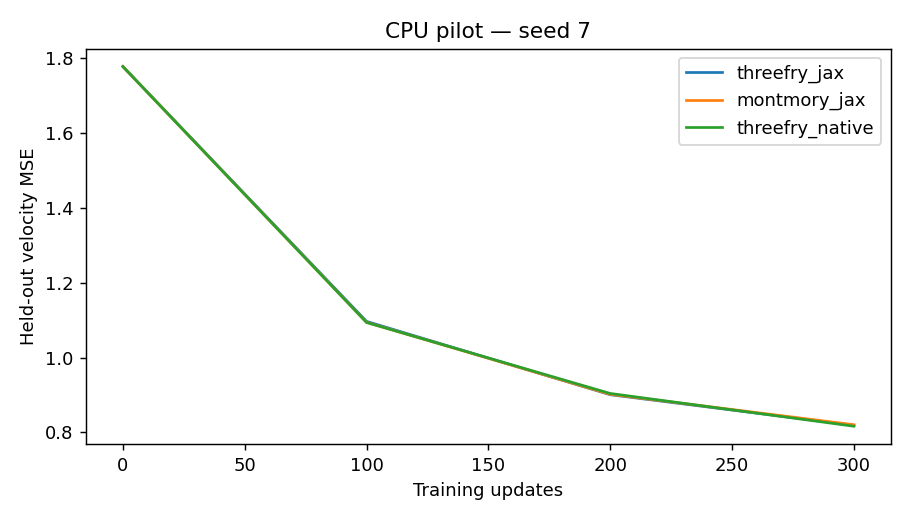
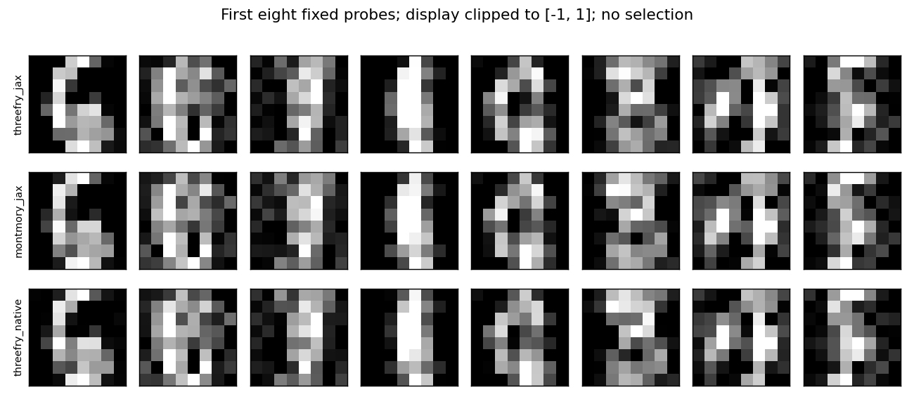

# Small image generator: diffusion / flow matching

[Français](README.fr.md) · [English](README.md) · [Home](../../README.md)

By Pascal Montmory for ENINCA CONSULTING. **CPU-executed prototype; native TPU compilation and performance are unvalidated.** Historical Montmory and Threefry kernels are unchanged. The [rights notice](../../LICENSE) and [third-party notices](../../THIRD_PARTY_NOTICES.md) apply.

[Open in Colab](https://colab.research.google.com/github/pascalMontmory/montmory-prng-research/blob/main/applications/diffusion/notebooks/Eninca_Diffusion_TPU.en.ipynb) · [English notebook](notebooks/Eninca_Diffusion_TPU.en.ipynb) · [Notebook français](notebooks/Eninca_Diffusion_TPU.ipynb)

## Research question

Does generating and applying noise inside one Pallas kernel improve a complete training step? The primary comparator is the same engine's JAX path with the same Gaussian transformation. The program also retains `jax.random.normal` as a standard application baseline. A slowdown is a valid result and must be retained.

The model learns to transform Gaussian noise into 8 × 8 digit images. This is **rectified flow matching**, related to the Flax generative example; it is neither a Stable Diffusion reimplementation nor a large-model demonstration. Interpolation is `x_t=(1-t)z+t*x`, with velocity target `x-z`, uniform `t` in `[0,1)` and squared-error loss.

## Fixed protocol

- `sklearn.datasets.load_digits`: 1,797 images, 1,400 training and 397 held out. Pixels scaled to `[-1,1]`; fixed permutation and recorded dataset hash. The data comes from scikit-learn, not ENINCA.
- MLP 80 → 128 → 128 → 64: pixels plus 16 sinusoidal time features, SiLU activations, Adam at 0.001, batches of 128. Initialization, examples, times and batch order match across variants within a seed.
- `--quick` pilot: 300 updates, seeds 7 and 19. Full protocol: 1,500 updates, seeds 7, 19 and 42. No selection of the best training run after observing results.
- CPU: Threefry JAX/Box–Muller, Montmory JAX/Box–Muller, and native JAX Threefry normals. TPU adds both Pallas paths with fixed 8 × 128 pair tiles.
- Validation uses held-out noise and times shared by every model. Velocity MSE alone does not quantify image quality. No FID or statistical superiority claim is made.
- Generation: 40 explicit Euler steps from 64 fixed initial noise arrays shared across variants. Every numerical sample is saved; the plot shows the first eight without selection. Only the display is clipped to `[-1,1]`.

## Contract and correctness

Uniforms use the exact float32 midpoint grid `((uint32 >> 9)+0.5)*2^-23`, then both Box–Muller outputs. The resulting normal is a discrete approximation with bounded tails. `jax.random.normal` uses a different transformation: its outputs need not match Box–Muller.

Montmory retains T=2048,D=4096. Pair `i` uses the low and high halves of word `base+i`. At step `s`, the base is `2^32-4097+s*(batch*64/2)`. Threefry uses flattened positions `2*i,2*i+1` of the partitionable 20-round JAX stream, with key derived by `fold_in(seed_high)` and then `fold_in(step)`. Changing batch shape changes the Montmory application contract. No distributed contract is added.

Verification compares Montmory to C, Threefry to the JAX API, and fused outputs to a NumPy float64 transformation. It covers tails, two tiles, extreme seeds and carries. One full Adam update is compared between JAX and Pallas for each engine. On CPU, **Pallas is interpreted for correctness, never timed as a TPU**.

Tolerances: fused outputs `atol=rtol=4e-5`, checked update `atol=5e-6,rtol=5e-4`; TPU campaigns compare losses and trained states with `atol=2e-4,rtol=2e-3`. Integer equality does not imply bitwise-equal floating transformations or training across architectures. The program differentiates model weights; it does not provide a general primitive differentiable with respect to images or RNG parameters.

## Measurement and available results

Every full-step pipeline is compiled and warmed before measurements. Variant order is shuffled at each update. Timing includes noise, preparation, forward pass, gradients, Adam and synchronization. Data is resident; batch preparation, compilation, evaluation and image generation are excluded. Pallas also produces the velocity target required by the loss: no global memory reduction is claimed without profiling.

[CPU report](validation/cpu/report.json) · [Per-step timings](validation/cpu/steps.csv) · [Learning curves](validation/cpu/learning.csv). The pilot demonstrates execution and decreasing held-out loss, not commercial superiority or TPU performance. It adds no PRNG statistical battery.





## Reproduce

Python 3.11+ and a C compiler, from the repository root:

```bash
python -m pip install -r applications/stochastic/requirements-cpu.txt
python applications/diffusion/run.py --backend cpu --quick --out build/diffusion-new
# Add --verify-only for checks without training.
```

On an allocated TPU, use the notebook or install `jax[tpu]==0.10.2` alongside the pinned dependencies, then replace `--backend cpu` with `--backend tpu`. Remove `--quick` for the full protocol. Each output directory must be new. Failures produce diagnostics; there is no silent CPU fallback. The notebook uses the reader's Colab account and quotas. No automatic transmission.

The [notebook builder](../stochastic/build_notebooks.py) produces both languages and a self-contained SHA-256-checked kit. `report.json` records versions, sources, environment, protocol and results. CPU durations do not predict TPU durations.

## References

- [Official Flax generative example](https://flax.readthedocs.io/en/latest/examples/digits_diffusion_model.html): flow-matching context; our MLP does not reuse its U-Net architecture.
- [Flow Matching for Generative Modeling](https://arxiv.org/abs/2210.02747) and [Flow Straight and Fast](https://arxiv.org/abs/2209.03003).
- [scikit-learn digits](https://scikit-learn.org/stable/modules/generated/sklearn.datasets.load_digits.html), from UCI Optical Recognition of Handwritten Digits.
- [Pallas PRNG](https://docs.jax.dev/en/latest/pallas/tpu/prng.html).
