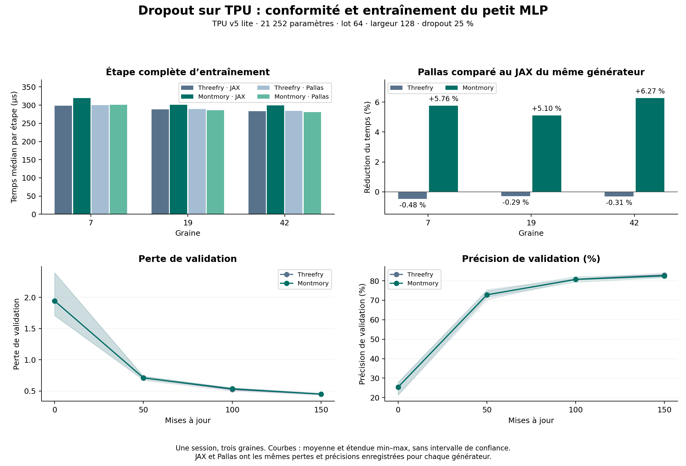

# Native TPU dropout — 24 October 2026 results

[Français](README.fr.md) · [English](README.md)

[Experiment and mask contract](../../README.md) · [Original report](report.json) · [Recomputed audit](analysis/audit.json)

**Dropout works in native TPU training. Pallas reduces Montmory step time by
5.10–6.27% against Montmory JAX. Performance remains close to Threefry;
no general advantage over that comparator is established.**

## Received run

One Colab session started on 24 October 2026 at 10:11:28 UTC on **one TPU v5 lite**.
JAX/jaxlib 0.10.2, libtpu 0.0.42.1, NumPy 2.1.3, `highest` matrix multiplication
precision. A 32 → 128 → 128 → 4 MLP, 21,252 parameters, batch size 64,
25% dropout, SGD at 0.1, 150 updates, seeds 7, 19 and 42.
The synthetic task has 2,048 training and 512 validation examples.
All four variants share data, batch order and initial weights for each seed.

Measurements include forward pass, backward pass, update, dispatch and
synchronization. Data and batches reside on the device. Preparation, batch
extraction, compilation and validation evaluation are excluded from step timing.
All variants are compiled and warmed before measurement, then interleaved in
random order at every step. The recorded 17.55-second total also includes
verification and compilation; it is not one variant's training time.

## Conformance

- All 19 manifest hashes match the [original source kit](source-kit.tar.gz),
  including 10 execution sources identical to this publication's repository files.
- CPU reconstruction of the dataset and batch order reproduces their hash.
- All 1,800 [measurement rows](steps.csv) are present without duplicates; report
  medians and ratios are recomputed independently of the training runner.
- The native report records **49,672 mask-element comparisons** and as many
  gradient-element checks passing, two tile sizes, tails, four conformance seeds
  and six address-schedule checks.
- All **900 JAX/Pallas training-loss pairs** and 18 validation-point pairs are
  numerically identical for the same engine and seed.
- The runner reports a maximum **zero final-weight difference** for all six
  engine/seed pairs. Weight tensors were not included in the archive: this last
  check is reported by the runner and is not replayed from exported weights.

These checks establish neither universal cross-architecture identity nor a new
statistical property of the PRNG. No TestU01 battery was run here.

## Step times

Median of 150 observations per variant and seed, in milliseconds:

| Variant | Seed 7 | Seed 19 | Seed 42 |
|---|---:|---:|---:|
| Threefry JAX | 0.2988245 | 0.2885500 | 0.2834850 |
| Montmory JAX | 0.3194850 | 0.3013550 | 0.2994900 |
| Threefry Pallas | 0.3002600 | 0.2893900 | 0.2843500 |
| Montmory Pallas | 0.3010800 | 0.2859750 | 0.2807155 |

Pallas reduces Montmory time by **5.76%, 5.10% and 6.27%**, saving about
15–19 µs per median step. The median JAX/Pallas ratio is 1.0611:
**6.11% greater throughput corresponds to 5.76% less time**.

Against Threefry JAX, Montmory Pallas takes 0.75% more time for seed 7, then
0.89% and 0.98% less for seeds 19 and 42. Against Threefry Pallas, the time
differences are +0.27%, −1.18% and −1.28%, respectively.
These small differences of varying sign do not establish a general speed
advantage. Three trajectories from one session are not three independent
benchmark sessions; no confidence interval is claimed.

[Detailed statistics](analysis/timing_summary.csv) · [Ratios and paired differences](analysis/comparisons.csv) · [50-step blocks](analysis/timing_by_block.csv)

## Threefry in JAX and Pallas

Both paths use **20-round Threefry2x32**. The JAX path uses
`jax.random.bernoulli` in the ordinary graph. Our Pallas path computes the same
words at the same indices inside a kernel that generates and applies the mask.
Its custom derivative regenerates that mask for the backward pass.
This run's results are numerically identical, while Pallas takes about
0.3–0.5% more time for the complete Threefry step.

Pallas is a [JAX extension for writing kernels](https://docs.jax.dev/en/latest/pallas/quickstart.html).
Generating values inside the consuming kernel can reduce memory traffic,
but does not guarantee faster training.
The [hardware PRNG accessible through Pallas](https://docs.jax.dev/en/latest/pallas/tpu/prng.html#using-the-hardware-prng)
is a different generator; **it is not used in this comparison**.
No total memory saving was measured.

## Learning and CPU/GPU comparison

| Seed | Initial accuracy | Threefry after 150 steps | Montmory after 150 steps |
|---|---:|---:|---:|
| 7 | 26.95% | 84.18% | 83.20% |
| 19 | 27.93% | 82.03% | 82.81% |
| 42 | 21.29% | 82.81% | 81.64% |

Mean final accuracy is 83.01% for Threefry and 82.55% for Montmory.
Mean final loss is 0.4481 and 0.4504. Both learn this task; these three seeds
establish neither superior quality nor statistical equivalence.
The experiment does not show that Montmory reaches a target accuracy in fewer steps.

The [21 October CPU check](../cpu/report.json) uses the same execution sources,
dataset, batches and dimensions. Its median Montmory JAX times are
0.447087 / 0.4218075 / 0.4179535 ms for the same seeds. Comparing these with the
TPU gives about **1.40× for Montmory JAX** and **1.48× for Montmory Pallas**,
or 32.2–32.8% less time for the latter.
**This comparison is indicative: the VPS CPU run was a functional check in a
separate session, not a controlled hardware benchmark.** It cannot attribute
the difference to the PRNG alone. No GPU training run of this model was measured.
[CPU/TPU calculations](analysis/cpu_comparisons.csv).



The figure uses the mean and minimum–maximum range across three seeds for the
learning curves, without confidence intervals. [PDF version](analysis/dropout-tpu-analysis.pdf).

## Replay the analysis and continue

From the repository root, with NumPy installed:

```bash
python3 applications/dropout/analyze.py --out build/dropout-tpu-audit
```

Add `--plots` with Matplotlib installed to regenerate figures. This script
checks archives, sources and recorded measurements; it runs no TPU training.
Derived outputs are written outside this evidence directory.

The next workload specified by the protocol is `--batch 256 --width 256`, followed
by independent repetitions under the same conditions for all four variants.
The current small model does not support extrapolation to large models, multiple
devices, memory or energy. A practical advantage over Threefry remains unproven.

The [Sobol32 prototype for TPU](../../../sobol/README.md) is a separate
low-discrepancy point experiment with its own notebooks. CPU conformance is
checked; native TPU compilation and performance remain unmeasured.
It is not a variant of the dropout measured here.

## Retained provenance

The [received archive](dropout-tpu.tar.gz), [received manifest](manifest.json),
[log](run.log), [raw curves](learning_curves.csv), [checksums](SHA256SUMS) and original
kit are retained unchanged. Embedded READMEs describe the state before this run;
they do not supersede this dated analysis. A Git commit was unavailable in Colab:
provenance rests on file hashes.

Received archive SHA-256:
`db392503b39399a86c6307a0700d226ccef46cadd40e95e70328d99a0fdd6deb`.
The only log warning concerns transparent hugepages at runtime startup and
shutdown; no failure is reported.
