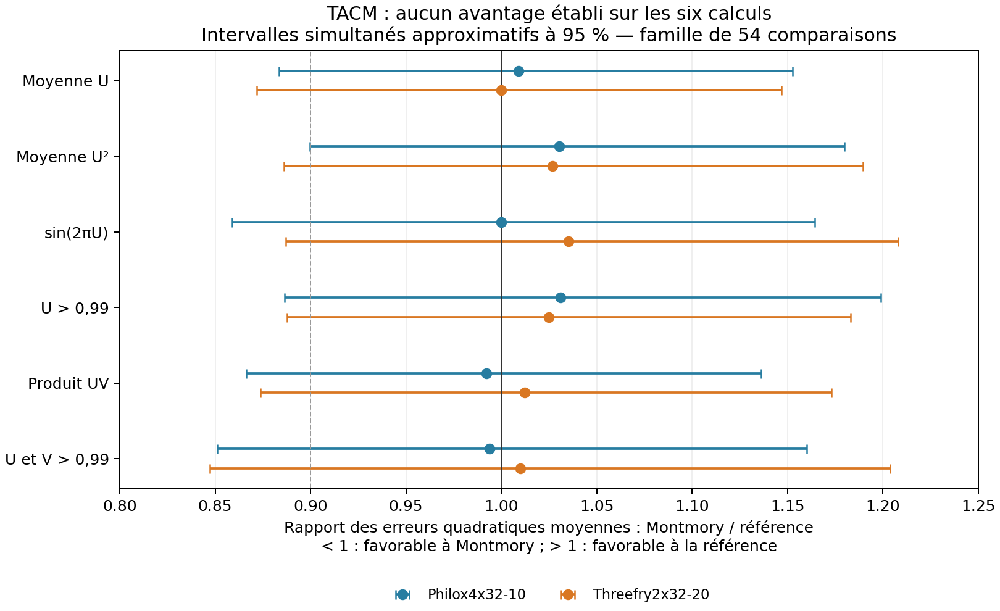

# Comparaison TACM de Montmory et de neuf références

21 octobre 2026. Campagne exécutée sur CPU x86_64, VPS AMD EPYC-Milan sous KVM. **Aucun avantage statistique de Montmory n'est établi par cette campagne.** Ses résultats sont compatibles avec les références sur les six calculs étudiés. Cela constitue une absence de différence détectée à cette échelle, pas une preuve d'équivalence ou une garantie générale de qualité.

Les résultats, sources, paramètres et scripts sont conservés dans ce dossier. Le code et les kits Metal/CUDA livrés auparavant n'ont pas été modifiés. La revue des générateurs et de leurs antériorités est dans [SOURCES.md](SOURCES.md).

**Ce qui a été exécuté.** Dix moteurs, chacun sur 2 048 seeds déterministes distinctes, regroupées en 128 groupes de 16 répétitions. Chaque répétition produit 65 536 mots de 64 bits : **1 342 177 280 mots pour la comparaison fonctionnelle**, donnant 122 880 estimations. Tous les moteurs passent par la conversion `(raw64 >> 11) × 2^-53`. Deux sorties MT19937 de 32 bits sont assemblées avant cette conversion. Les initialisations restent propres à chaque moteur.

Montmory conserve la géométrie logique `T=2048, D=4096` du test Metal en cours. Les 65 536 premiers indices couvrent les 16 premières lanes logiques. Un contrôle distinct prélève 16 positions dans chacune des 2 048 lanes, sur 64 seeds, pour Montmory, Philox4x32 et Threefry2x32. Il ne prétend pas vérifier toutes les dépendances entre toutes les lanes.

**Qualité des estimations.** Le tableau donne l'erreur quadratique moyenne divisée par la variance théorique d'une moyenne IID. La référence idéale vaut 1 ; une observation ponctuelle inférieure à 1 n'est pas une preuve de supériorité.

| Moteur | Moyenne U | Moyenne U² | Sinus | Événement U > 0,99 | Produit de deux U | Deux U > 0,99 |
|---|---:|---:|---:|---:|---:|---:|
| Montmory | 0,978 | 0,987 | 0,995 | 1,016 | 0,966 | 1,003 |
| Philox4x32-10 | 0,969 | 0,958 | 0,995 | 0,985 | 0,974 | 1,009 |
| Threefry2x32-20 | 0,978 | 0,961 | 0,961 | 0,991 | 0,954 | 0,993 |
| Threefry4x64-20 | 0,979 | 0,966 | 0,998 | 0,950 | 0,999 | 0,994 |
| xoshiro256** | 1,047 | 1,042 | 1,031 | 1,021 | 1,027 | 1,013 |
| PCG64 | 0,967 | 0,969 | 0,980 | 0,978 | 0,959 | 1,050 |
| PCG64DXSM | 0,998 | 0,990 | 0,990 | 0,973 | 1,002 | 1,000 |
| MT19937 | 1,079 | 1,075 | 1,031 | 1,077 | 1,041 | 1,069 |
| SFC64 | 0,999 | 1,017 | 0,987 | 1,021 | 0,994 | 1,048 |
| Philox4x64 NumPy | 1,024 | 1,014 | 1,036 | 1,057 | 1,032 | 1,050 |

Le critère fixé avant les résultats exigeait une baisse d'erreur supérieure à 10 %, une p-value corrigée inférieure à 5 % et un effet de même sens dans les deux moitiés prédéfinies des seeds. **0 comparaison sur 54 satisfait ce critère** ; aucune n'atteint même le seuil de signification corrigé sans la condition des 10 %.

L'écart ponctuel le plus favorable à Montmory est la moyenne U face à MT19937 : erreur environ 9,3 % plus faible, mais p-value corrigée **0,617**. L'intervalle simultané approximatif du rapport d'erreurs est **[0,786 ; 1,046]** : il contient 1. Il serait incorrect de présenter cet écart comme un avantage démontré. Les intervalles face à Philox/Threefry restent assez larges pour ne pas trancher des écarts de quelques pourcents. Voir [les 54 comparaisons](results/MSE_comparisons.csv).



La même figure est disponible en [PDF](results/MSE_ratios.pdf).

**Diagnostics complémentaires.** Les 93 tests agrégés couvrent les variances entre répétitions, les événements rares, les histogrammes, les couples disjoints, les quatre bits faibles bruts et les couples de lanes. **Aucune alerte après correction de Bonferroni sur les 93 tests.** Aucun groupe de répétitions n'a une variance nulle. Aucune duplication des signatures de 16 mots prélevés par lane n'est observée ; cela ne prouve ni l'absence de collisions de mots isolés, ni l'indépendance des flux.

La plus petite p-value brute est 0,002329 pour un diagnostic de variance de xoshiro256** ; elle devient 0,217 après correction. Nous ne la classons donc pas comme défaut établi. Les couples utilisent des observations disjointes pour éviter l'erreur de calibration identifiée dans l'ancien TACM. Les lois du χ² et les approximations normales restent explicitement approximatives. Voir [les diagnostics](results/diagnostics.csv) et [la méthode](METHODES.md).

La couverture observée de Montmory va de 94,68 % à 95,65 % pour les quatre calculs continus ; elle vaut 95,21 % et 98,10 % pour les événements rares. La dernière valeur reflète notamment le caractère conservateur et discret des intervalles binomiaux ; elle n'est pas une note de qualité supérieure.

**Calibration et modification du protocole.** Le premier essai, 512 réalisations par source de référence, n'a pas franchi deux portes de validation : 8 et 10 alertes sur 512 pour Philox4x64 donnaient des bornes supérieures d'incertitude dépassant 3 %. Ces données sont conservées dans [pilot-calibration.csv](results/pilot-calibration.csv).

Avant toute comparaison fonctionnelle, un [avenant explicite](calibration_addendum.json) a fixé une seule extension indépendante à 4 096 réalisations par source, sans changer les seuils. Les huit taux d'alerte s'étendent alors de 0,781 % à 1,196 % pour un seuil nominal de 1 % ; leurs bornes supérieures individuelles restent sous 1,58 %. Les trois défauts forts injectés sont détectés dans 4 096 cas sur 4 096, pour chacune des deux sources. Ce contrôle valide l'usage expérimental ciblé des diagnostics structurels ; il ne constitue pas une certification de l'ensemble de TACM, ni une preuve de sensibilité à des défauts faibles. Les sources de référence sont elles-mêmes des PRNG.

**Coût sur le CPU du VPS.** Médianes de 15 essais d'un million de mots environ ; initialisation, génération, interface hôte et conversion 53 bits incluses. Les moteurs sont mesurés successivement dans un ordre tournant. Il s'agit du coût de ces implémentations dans cette interface, pas de leur vitesse maximale théorique. La dispersion, l'allocation mémoire et la virtualisation limitent les comparaisons fines.

| Moteur | ns par mot, médiane | Quantiles 10–90 % |
|---|---:|---:|
| xoshiro256** | 2,625 | 2,519–3,234 |
| SFC64 | 4,142 | 3,971–4,862 |
| PCG64DXSM | 4,225 | 4,090–4,745 |
| Threefry4x64-20 | 5,275 | 5,063–6,204 |
| PCG64 | 5,298 | 4,973–6,243 |
| Philox4x32-10 | 6,500 | 6,095–10,861 |
| Montmory | 10,289 | 9,842–13,272 |
| Threefry2x32-20 | 11,232 | 11,002–14,645 |
| Philox4x64 NumPy | 11,593 | 10,928–12,922 |
| MT19937 | 12,092 | 11,056–13,529 |

Montmory délivre ici environ **9,2 % de mots par seconde en plus que Threefry2x32-20**, sur les médianes. C'est un résultat local de performance, dont les distributions se recouvrent ; il ne démontre pas un avantage général et plusieurs références sont nettement plus rapides. Threefry4x64 est plus rapide ici que Threefry2x32 : les variantes et les architectures comptent. Voir [les 150 mesures](results/timings.csv).

Sur le M3, les mesures Metal v3 transmises précédemment par l'utilisateur donnaient environ 72,8 Go/s pour Montmory `mulhi_pair`, contre 84,7 pour Philox4x32 et 88,4 pour Threefry2x32 en sortie 53 bits stockée sur 64 bits. Ces chiffres antérieurs ne sont pas réexécutés dans cette campagne. Aucun avantage GPU n'est démontré. SmallCrush et Crush natifs Metal ont été rapportés comme réussis ; le dernier extrait BigCrush reçu est encore incomplet.

**Ce que ces résultats apportent au projet.** Montmory fournit ici des estimations sans anomalie détectée dans le périmètre choisi, mais TACM ne justifie pas de le qualifier de plus précis que les références. Le parallélisme et la reproductibilité sont des propriétés utiles déjà présentes ailleurs. Pour démontrer une supériorité, il faudrait une propriété mathématique supplémentaire ou un gain confirmé sur une application et un matériel définis. Cette campagne fournit surtout un outil pour vérifier une telle revendication sans sélectionner les seeds ou les diagnostics qui favorisent Montmory.

Les anciens indicateurs non justifiés — borne universelle de variance à partir d'un gap, score `bridge_gap` nul par construction, mélange de scores sans calibration — ne sont pas réintroduits. La campagne applique un sous-ensemble corrigé de TACM ; elle ne transforme pas les anciens résultats en preuves.

**Reproduction.** Sources locales embarquées, Random123 fixé par commit, NumPy 1.24.2, SciPy 1.10.1, pandas 1.5.3, Python 3 et g++ 12.2. Le fichier `requirements.txt` décrit les versions Python. Le binaire est compilé avec `-O3 -march=native` ; un exécutable distinct vérifie les calculs entiers avec UBSan. Il faut un environnement Linux x86 compatible ou adapter explicitement le build en conservant ses nouvelles preuves de conformité.

Pour recalculer l'analyse des résultats fournis :

```bash
python3 analyze.py
```

Pour refaire toute la campagne, dans **une nouvelle copie** de ce dossier, préserver les résultats livrés puis lancer :

```bash
mv results reference-results
python3 reproduce.py
```

Les phases refusent de remplacer silencieusement des résultats déjà enregistrés. `reproduce.py` s'arrête si la calibration pilote ne reproduit pas le cas archivé. Les temps varieront ; des différences de bibliothèque mathématique peuvent aussi affecter les derniers bits des statistiques flottantes. Les mots entiers des moteurs et les estimateurs ne doivent pas être confondus sur ce point.

Un contrôle additionnel a régénéré 180 estimations sélectionnées, avec des réductions scalaires indépendantes par `math.fsum` : accord à moins de 2×10^-15. Les variances polynomiales ont aussi été recalculées en fractions exactes. Rejeu : `python3 verify_replay.py`. La figure optionnelle se régénère avec `python3 plot_results.py` et matplotlib (3.6.3 ici).

Fichiers principaux : [protocole initial](protocol.json), [conformité native](results/conformance.json), [exécution et versions](results/execution.json), [métriques](results/metrics.csv), [résumé machine](results/summary.json), [journal](PROGRESS.md). Les fichiers `results/estimates-*.csv` contiennent toutes les estimations individuelles, leurs seeds et les effectifs d'événements ; ils ne stockent pas les 10,7 Go de mots bruts, qui sont régénérables.
